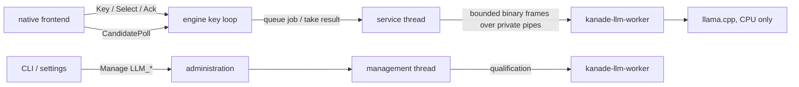

# Local reranking model

An optional local language model reorders the Mozc candidates of the focused segment, using the text before the cursor. It is off by default. The Windows and macOS installers include the pinned Tsumugi GGUF. Each user can import it from settings after accepting the model and local-processing terms. The engine qualifies it before reranking can be enabled.

Each importable file is registered together with a profile that fixes how it is loaded, prompted, scored and qualified. Registrations are compiled into Kanade. One model is installed at a time.

When conversion starts at the beginning of a field, the model can use the preceding segments of that conversion to choose the spelling of the final inflected word. The frontend can show the revised preedit until the user navigates, types or commits. The engine compares existing Mozc choices.

## Components



| Part | Location | Role |
|---|---|---|
| Policy, records, service, qualification | `crates/kanade-llm` (default build) | No inference and no native code |
| Registry of models and profiles | `crates/kanade-llm/src/profile.rs`, `prompt.rs` | Compiled-in identities, formats, corpora and gates |
| Worker | `crates/kanade-llm/src/bin/worker.rs`, feature `llama` | The only process that loads the model |
| Engine integration | `crates/kanade-engine/src/refine.rs` | Queues jobs, answers polls, applies an order |
| Management | `crates/kanade-engine/src/server/admin.rs` | `LLM_STATUS`, `LLM_IMPORT`, `LLM_QUALIFY`, `LLM_REMOVE` |

The key loop copies a few short strings into a queue of two jobs and later looks a result up. Both operations take a lock that is only held for a few memory operations. Spawning, loading, hashing, timeouts and restarts happen on the service and management threads.

### Building the worker on Windows

For `x86_64-pc-windows-msvc` the llama.cpp runtime is compiled with clang-cl under Ninja, whichever Visual Studio is installed. `.cargo/config.toml` hands `CMAKE_GENERATOR_x86_64_pc_windows_msvc` and `CMAKE_TOOLCHAIN_FILE_x86_64_pc_windows_msvc` to the build script of `llama-cpp-sys-2`, and the [toolchain file](../crates/kanade-llm/toolchain/x86_64-pc-windows-msvc.cmake) chooses the compiler. Other targets read neither. The Microsoft headers, libraries and linker are still those of the installed Visual Studio.

The compiler of Visual Studio 2022 (MSVC 19.44), which the release and CI images have, keeps the accumulators of the runtime's matrix kernel in memory and loads and stores them in every step. Visual Studio 2026 (MSVC 19.51) keeps them in registers. A released worker therefore scored about 40 % slower than one built on a machine with Visual Studio 2026. clang-cl keeps them in registers once its instruction scheduler leaves the kernel in source order (`-enable-misched=false`). It compiles without contracting a multiplication and an addition into one rounding (`-ffp-contract=off`), so its scores equal those of an MSVC build bit for bit.

On the development PC, each worker answered the 85 ranking requests of the qualification 16 times, 1,360 requests in all, in one run with the bundled model:

| Worker | Median | 95th percentile |
|---|---:|---:|
| Release 26.11.118-preview.8 | 19.6 ms | 30.4 ms |
| Built with MSVC 19.44 (Visual Studio 2022) | 19.1 ms | 29.7 ms |
| Built with MSVC 19.51 (Visual Studio 2026) | 13.8 ms | 20.1 ms |
| clang-cl, in the Visual Studio 2022 environment | 13.3 ms | 19.2 ms |
| clang-cl, in the Visual Studio 2026 environment | 13.4 ms | 19.2 ms |

All five returned the same scores for every request.

The build needs clang-cl from LLVM, found on `PATH`, in `LIBCLANG_PATH`, under `Program Files\LLVM` or in Visual Studio's own copy of LLVM, and Ninja, found on `PATH` or among the C++ CMake tools of Visual Studio. A target directory that already holds the runtime keeps its earlier build when either setting changes: remove it with `cargo clean -p llama-cpp-sys-2`, with the profile and target options of the build.

## Tsumugi model

Kanade accepts one local reranker, **Tsumugi 26.11.105**. Model versions use Japan time and the form `yy.mm.counter`. The counter starts at 100 each month and increases for each model release, independently of the IME version. Its F16 GGUF contains 28,058,112 parameters and occupies 66,507,360 bytes. The weights learned to write the text of Japanese Wikipedia from its reading, and then to compare the spellings Mozc offers. The articles and sentences used to measure conversion were left out. The engine, worker and settings use the same pinned identity. The Windows EXE installs the GGUF in the application’s `models` directory. The macOS DMG includes it under `Settings.app/Contents/Resources/models` inside Kanade.app. Model distribution terms are separate from the Kanade source license. [GGUF identity and qualification profile](../locks/llm.lock.toml) · [Training data](third-party.md#tsumugi-training-data)

A Windows x64 build of the engine and worker matched all 373 tokenizer references and ranked the expected candidate first in 82 of 85 context tests (96.47%). Every case received a score. Repeated runs agreed. CPU scoring took 12 ms at the median and 18 ms at the 95th percentile on the development PC. The 85 examples exercise selected homophones. Through the engine’s Windows pipe, an empty field displayed 車に乗ります and 雑誌に載ります after one press of Space, with and without punctuation. The measurement closes each conversion without recording a selection.

For an initial conversion with confirmed text before the caret, the worker also scores candidate spellings with a character model trained on Japanese text. It reads up to four preceding characters for each character it predicts. Tsumugi 26.11.105 weights neural log scores by 4 and character log scores by 1.5. The GGUF stores both weights and character probabilities. Focused-segment scoring, conversion in an empty field and the neural qualification suite use the original neural scores.

## Prompt and score

Tsumugi scores a replacement for the focused segment using the last 40 characters of left context, the composition reading in katakana and the complete displayed surface. It removes line breaks and maps ASCII spaces to ideographic spaces. Its 7,680-token vocabulary supports UTF-8 byte fallback.

```text
U+E080 context U+E081 KATAKANA-READING U+E082 surface END
```

The worker sums continuation log probabilities, including end token 259. It omits the context marker for empty context and adds no start token. Request fields reserve U+E080–U+E08F.

## Privacy and bounds

A job is queued only when all of the following hold. Otherwise nothing leaves the key loop.

- `llm` is enabled and a qualified model is being served.
- The context is `NORMAL` after the engine applies learning exclusions. Password input is refused earlier; private and unknown contexts, excluded applications and a disabled learning switch all yield no job.
- The frontend can read surrounding text. At the beginning of a field, a conversion of two to four segments can supply its own prefix.
- The window, and the text it may have been cut from, contain no `@`, `/`, `\`, `:`, control character or long credential-like token.
- The reading is 2–64 kana, and at least two Mozc choices of at most 32 characters are among the first nine.
- No text of the job contains a marker or reserved character of the served model's profile.
- The user has not picked a candidate in this conversion.

| Bound | Value |
|---|---|
| Candidates per job | 9 |
| Prompt / continuation tokens | 192 / 112; a longer request is refused, not truncated |
| Context size, threads | 320 tokens, 4 |
| Time budget inside the worker | 500 ms, enforced by the runtime's abort callback |
| Hard timeout in the parent | 900 ms, then the process is killed |
| Result lifetime | 700 ms from submission |
| Queue | 2 jobs; the oldest is dropped |
| Frame size | 64 KiB |
| Restarts | Delays of 1 s and 10 s; after three consecutive failures the service stops until it is activated again |
| Idle | The worker is stopped after ten minutes without a job |

The worker has a cleared environment and private pipes. On Unix its frame channel is duplicated before standard output and error are redirected to the null device; the runtime's log callback discards everything. On macOS it additionally denies itself network access, file writes and process creation before reading any request. Errors are fixed enumeration values. KV memory and the input batch are cleared after every scoring request, including failures. The in-memory result cache is keyed by a digest of the request together with the served file and profile, holds scores only and is emptied whenever the served model changes. Records on disk contain identities, counts and durations. The status reply contains no path.

## Candidate updates

The additions to `proto/kanade.proto` are `CandidatePoll`, `CandidateUpdate` and `CandidatePage.refinement_pending`.

1. A key reply sets `refinement_pending` when a job was queued for its page.
2. After acknowledging the event, the frontend sends `CandidatePoll` with the reply's revision and the page's candidate revision.
3. A candidate-only poll receives a `CandidateUpdate`. A focused native editor may also provide its next event sequence to accept a revised preedit. The editor acknowledges that edit through the same path as a key reply.
4. A new page replaces the displayed one. It has a new candidate revision and new handles; handles of the old page are refused as stale.

With preceding document text, the following rules govern the candidate list.

- Only Mozc choices among the first nine slots move. Learned, project, date and emoji choices keep their slots.
- The selected choice keeps its slot, so Enter commits the surface that was displayed.
- The source of every choice stays `MOZC`. Selection resolves the real upstream candidate again.
- The best alternative is annotated `文脈` when the model prefers it over the displayed one.
- Any key, selection, reset, close, setting or model change cancels the job. A result is applied only to the exact revision and candidate identities it was computed for, and only after the acknowledgement.
- An applied order stays while the same candidates are on screen. After a manual choice nothing is reordered until the conversion ends.
- A repeated poll or key event returns the applied page again without new work.

With confirmed preceding text, Kanade scores the conversion in windows of up to eight segments and 32 characters. The background poll reads up to 32 distinct Mozc choices per segment and tries up to two reading boundaries in a disposable session. The boundary probabilities were learned from Microsoft IME phrase analyses that agreed with the source spelling. A second cut can include a neighboring segment. Every clause of a punctuated input is a window, and a long clause is split into consecutive ones, up to four windows for one conversion. Each window keeps the text and punctuation displayed around it, and the accepted spellings are shown together in one preview. No further window starts 350 ms after the conversion.

For each window the engine submits up to 96 full spellings. Tsumugi retains the first nine and uses its character model to shortlist more for neural scoring. An original alternative needs a clear score lead over the displayed spelling, and an added alternative a further lead over the runner-up. A close challenger leaves the original comparison in effect. Manual choices, learned preferences and the spelling safeguards for names still take precedence.

Mozc can read a number as unrelated words: せんきゅうひゃくろくじゅうきゅう comes back as four segments, none of them a number. The engine looks for two or more numeral words in the kana of consecutive segments of a clause, wherever the segment boundaries fall. No window begins inside such a number. Its window gets that range cut again as one segment, written with kanji numerals and with ASCII digits. The kana of the first and last segment outside the number keep their displayed spelling. Both spellings take places among the first nine, which are always scored. They are one alternative: the notation that the registered lead for digits prefers needs the same lead over the displayed spelling as any other alternative. Digits are compared with digits. Where the display shows a numeral in that range, the model favors any spelling with digits over it, so the number's digits must also lead the display written with digits: 49 is weighed against 4級, not against 四級. That spelling of the display is scored for the comparison even where Mozc does not offer it, and the comparison alone never selects it. It takes a free place among the nine or the place of a second or third alternative. The first alternative of every segment keeps its place: where no other place is left, the number's kanji numerals give theirs, and the number is compared in digits alone. Where the spelling safeguards would refuse the digits, as beside a long katakana name with weights that keep kanji there, the kanji numerals stand for the number instead. While a window is looked at again, an accepted number keeps its kanji numerals, and so it does where they were not scored beside the digits. Its digits are compared once the words are settled, as for every number, also where no counter follows. A word that only reads like a number stays as displayed: a reading within one segment such as 二重に or 三銃士, 二重 and 三重 before another word, に and さん that Mozc wrote in kana after a numeral, a row of digit words none of which Mozc wrote as a numeral, and a range that already shows a number.

After the words of a window are chosen, the same text is compared with its numbers written in ASCII digits. Kanji numerals and wide digits followed by a counter or a katakana word are offered; vague amounts such as 数十 and words such as 十分 are not. Committed text that shows ASCII digits settles a tie for digits. A calendar year spoken across segments is written in digits before scoring and is not scored again. It needs no score: when the search or a score is still pending 600 ms after the conversion, the year is displayed with what has been decided by then. A year before 1100 that follows に is the exception. に can be the first digit of 20xx there, so both readings are offered as numbers and scored. When the conversion contains ASCII digits and the committed text has no wide digit, remaining wide digits are made ASCII too.

The leads, the number of shortlisted candidates, the number of spellings accepted per window and the amount of katakana beside which kanji keep their spelling are registered with each model file in `kanade-llm`'s catalogue and recorded as `preview` in `locks/llm.lock.toml`. They describe how sharply one set of weights separates spellings and where it is trusted, and change only together with the file. Tsumugi 26.11.105 uses a lead of 3.0 for a text and for a clause, 2.0 more for an added alternative, six shortlisted candidates, a lead of 4.0 for digits without committed digits, and up to two accepted spellings per window. Its registration sets no amount of katakana, so it may respell kanji beside a transliterated name. Spellings with a middle dot, kana written for a compound of two or more kanji, and katakana words of three or more characters stay as displayed for every model.

At the beginning of a field, the engine opens a temporary Mozc session to obtain the last segment’s alternatives. It checks the segment readings against the live conversion and compares single-kanji spellings with the same kana ending. A clear score advantage can produce one whole-reading preview. The model does this after the original key reply has been acknowledged. Typing, navigating or changing focus supersedes the job. Pressing Enter commits the visible spelling. An automatic preview creates no dictionary entry.

## Installing a model

Import the supplied Tsumugi GGUF after reviewing the displayed model and local-processing terms. The engine qualifies the file through its CPU worker. Qualification records bind the file, vocabulary, prompt and worker digests.

```sh
kanade-ui models import /path/to/tsumugi.gguf --accept-license --accept-local-processing
kanade-ui models status
```

Each Kanade release carries the model its installers bundle. The command below finds that file among the release assets by its SHA-256, checks it against `locks/llm.lock.toml`, keeps the copy in `artifacts/models/` and prints its path. Packaging runs the same step when no copy is there.

```sh
python3 .github/scripts/bundled_model.py --fetch
```

## Qualification

The worker must reproduce 373 independent tokenizer examples. On the 85 context-dependent ranking fixtures it must score every candidate, produce deterministic results, respect request bounds, choose at least 77 expected spellings and finish 95 percent of requests within 300 ms.

```sh
KANADE_LLM_MODEL=/path/to/tsumugi.gguf cargo test --release -p kanade-llm --features llama --test real_model -- --ignored --test-threads 1
```

## After an update

A qualification record names the worker binary that made it. Every release builds the worker again, so after an update the record names another worker and no longer applies (`runtime_changed`). The engine compares the worker before the profile, the prompt and the corpora. The reason therefore does not say that the worker is all that changed: the rest of the build may differ as well.

When reranking is switched on, the engine qualifies the installed model again by itself. It needs no new consent for that. The engine has already established that the installed file is the registered one and that the stored consent covers the current terms; otherwise the reason is `model_changed` or `consent_changed`. The measurement uses the profile of the installed build and the fixtures compiled into it, reads no text of the user and stays on the computer. This holds whatever else of the build changed, so the engine does not try to tell a changed worker from a changed profile.

The engine reserves this qualification in the step in which it reads the records, so the settings never show the model switched on, stale and idle. When an import was accepted before the records were read, the engine's own qualification follows once that job has ended, if the reason still applies. It starts once per engine process. A qualification that fails is not repeated, and one that is interrupted, for example by shutting the computer down, is not resumed: the record was cleared when it started. The user qualifies again from the settings then. While reranking is switched off, the engine measures nothing by itself, and the settings ask for a qualification before reranking can be switched on.

A release that bundles another model needs that model imported again, with its terms (`model_changed`).

`install.bat` waits for a qualification that the engine has started before it decides whether to import the bundled model.

## Asking for the settings

Reranking can be switched on while nothing is served and only the user can change that: the bundled model or its terms changed, a qualification failed, the installed model was removed while the setting stayed on, or the service stopped after the worker refused the model or failed repeatedly. The candidate window then says `AI は設定が必要・通常候補`, and the settings show the reason. `REFINEMENT_OUTCOME_SETUP_REQUIRED` carries this in `CandidatePage` and `CandidateUpdate`; a frontend that does not know the value shows the ordinary candidate status.

The window says so for a conversion that would have been scored: one whose focused segment forms a job, or one whose whole text would be compared, as at the beginning of a field. For such a conversion no search is started and no further job is offered to the service. A calendar year needs no model and is still shown. A conversion that is not scored anyway, as in a private context, keeps the ordinary status.

While an import or a qualification is running, the user is not asked for anything, and the window says `AI 評価できず・通常候補`.
