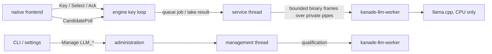

# Local reranking model

An optional local language model reorders the Mozc candidates of the focused segment, using the text before the cursor. It is off by default. The Windows and macOS installers include the pinned Tsumugi GGUF. Each user can import it from settings after accepting the model and local-processing terms. The engine qualifies it before reranking can be enabled.

Each importable file is registered together with a profile that fixes how it is loaded, prompted, scored and qualified. Registrations are compiled into Kanade. One model is installed at a time.

The model never changes the preedit, a commit, the document or any learning record. Live conversion and writing assistance remain unimplemented.

## Components



| Part | Location | Role |
|---|---|---|
| Policy, records, service, qualification | `crates/kanade-llm` (default build) | No inference and no native code |
| Registry of models and profiles | `crates/kanade-llm/src/profile.rs`, `prompt.rs` | Compiled-in identities, formats, corpora and gates |
| Worker | `crates/kanade-llm/src/bin/worker.rs`, feature `llama` | The only process that loads the model |
| Engine integration | `crates/kanade-engine/src/refine.rs` | Queues jobs, answers polls, applies an order |
| Management | `crates/kanade-engine/src/server/admin.rs` | `LLM_STATUS`, `LLM_IMPORT`, `LLM_QUALIFY`, `LLM_REMOVE` |

The key loop copies a few short strings into a queue of two jobs and later looks a result up. Both operations take a lock that is only held for a few memory operations. Spawning, loading, hashing, timeouts and restarts happen on the service and management threads.

## Tsumugi model

Kanade accepts one local reranker, **Tsumugi S**. Its F16 GGUF contains 28,058,112 parameters and occupies 56,386,208 bytes. The engine, worker and settings use the same pinned identity. The Windows EXE installs the GGUF in the application’s `models` directory. The macOS DMG includes it under `Settings.app/Contents/Resources/models` inside Kanade.app. Model distribution terms are separate from the Kanade source license. [GGUF identity and qualification profile](../locks/llm.lock.toml)

A Windows x64 installation matched all 373 tokenizer references and ranked the expected candidate first in 78 of 85 context tests (91.76%). Every case received a score. Repeated runs agreed. CPU scoring took 21 ms at the median and 33 ms at the 95th percentile on the installation PC. The 85 examples exercise selected homophones.

## Prompt and score

Tsumugi scores a replacement for the focused segment using the last 40 characters of left context, the composition reading in katakana and the complete displayed surface. It removes line breaks and maps ASCII spaces to ideographic spaces. Its 7,680-token vocabulary supports UTF-8 byte fallback.

```text
U+E080 context U+E081 KATAKANA-READING U+E082 surface END
```

The worker sums continuation log probabilities, including end token 259. It omits the context marker for empty context and adds no start token. Request fields reserve U+E080–U+E08F.

## Privacy and bounds

A job is queued only when all of the following hold. Otherwise nothing leaves the key loop.

- `llm` is enabled and a qualified model is being served.
- The context is `NORMAL` after the engine applies learning exclusions. Password input is refused earlier; private and unknown contexts, excluded applications and a disabled learning switch all yield no job.
- The frontend reports surrounding text, and the context window is not empty.
- The window, and the text it may have been cut from, contain no `@`, `/`, `\`, `:`, control character or long credential-like token.
- The reading is 2–64 kana, and at least two Mozc choices of at most 32 characters are among the first nine.
- No text of the job contains a marker or reserved character of the served model's profile.
- The user has not picked a candidate in this conversion.

| Bound | Value |
|---|---|
| Candidates per job | 9 |
| Prompt / continuation tokens | 192 / 112; a longer request is refused, not truncated |
| Context size, threads | 320 tokens, 4 |
| Time budget inside the worker | 500 ms, enforced by the runtime's abort callback |
| Hard timeout in the parent | 900 ms, then the process is killed |
| Result lifetime | 700 ms from submission |
| Queue | 2 jobs; the oldest is dropped |
| Frame size | 64 KiB |
| Restarts | Delays of 1 s and 10 s; after three consecutive failures the service stops until it is activated again |
| Idle | The worker is stopped after ten minutes without a job |

The worker has a cleared environment and private pipes. On Unix its frame channel is duplicated before standard output and error are redirected to the null device; the runtime's log callback discards everything. On macOS it additionally denies itself network access, file writes and process creation before reading any request. Errors are fixed enumeration values. KV memory and the input batch are cleared after every scoring request, including failures. The in-memory result cache is keyed by a digest of the request together with the served file and profile, holds scores only and is emptied whenever the served model changes. Records on disk contain identities, counts and durations. The status reply contains no path.

## Candidate updates

The additions to `proto/kanade.proto` are `CandidatePoll`, `CandidateUpdate` and `CandidatePage.refinement_pending`.

1. A key reply sets `refinement_pending` when a job was queued for its page.
2. After acknowledging the event, the frontend sends `CandidatePoll` with the reply's revision and the page's candidate revision.
3. The answer is always a `CandidateUpdate`. It carries a new page, or `pending`, or neither. A stale, early or unknown poll is not an error.
4. A new page replaces the displayed one. It has a new candidate revision and new handles; handles of the old page are refused as stale.

The engine guarantees the following.

- Only Mozc choices among the first nine slots move. Learned, project, date and emoji choices keep their slots.
- The selected choice keeps its slot, so Enter commits the surface that was displayed.
- The source of every choice stays `MOZC`. Selection resolves the real upstream candidate again.
- The best alternative is annotated `文脈` when the model prefers it over the displayed one.
- Any key, selection, reset, close, setting or model change cancels the job. A result is applied only to the exact revision and candidate identities it was computed for, and only after the acknowledgement.
- An applied order stays while the same candidates are on screen. After a manual choice nothing is reordered until the conversion ends.
- A repeated poll or key event returns the applied page again without new work.

Because the preedit is never changed and choices only move within the first nine slots, the top-one and first-nine counts of the 152-case input regression cannot measure an improvement from this feature. The real socket contract instead checks that a warm model delivers a changed candidate revision without editing the document or changing the Enter commit. Broader comparisons with real Mozc lists remain future work.

## Installing a model

Import the supplied Tsumugi GGUF after reviewing the displayed model and local-processing terms. The engine qualifies the file through its CPU worker. Qualification records bind the file, vocabulary, prompt and worker digests.

```sh
kanade-ui models import /path/to/kanade-tsumugi-v0.1.0-s-F16.gguf --accept-license --accept-local-processing
kanade-ui models status
```

## Qualification

The worker must reproduce 373 independent tokenizer examples. On the 85 context-dependent ranking fixtures it must score every candidate, produce deterministic results, respect request bounds, choose at least 77 expected spellings and finish 95 percent of requests within 300 ms.

```sh
KANADE_LLM_MODEL=/path/to/kanade-tsumugi-v0.1.0-s-F16.gguf cargo test --release -p kanade-llm --features llama --test real_model -- --ignored --test-threads 1
```
